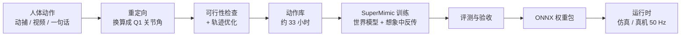

# LocoInfra

**人形机器人运动基础模型的全流程工具链：数据处理 → 训练 → 部署。**

> *English summary.* LocoInfra is an end-to-end pipeline for training a humanoid **base motion model** on the 22-DoF Q1 robot: human motion capture (LAFAN1 / AMASS) is retargeted, checked for physical feasibility and repaired, then used to train one controller with [SuperMimic](https://arxiv.org/abs/2610.28480) (a differentiable world model + short-horizon BPTT). The model has two goal encoders sharing one decoder — `E_ref` tracks full reference motions, `E_tele` follows sparse commands (velocity, height, torso tilt, hand positions) — and is exported as ONNX for a standalone 50 Hz runtime. Documentation is in Chinese.

LocoInfra 让一台小型人形机器人（Q1：22 个关节，高 0.88 m，重 16.9 kg）学会人的动作。它把动捕数据换算成机器人能做的动作，在仿真里训练出**一个通用控制模型**，再导出成可以独立运行的 ONNX 权重包。这个模型有两种用法：

- **照着参考做**：给一段完整的参考动作（走路、挥手、舞蹈……），机器人跟着做，训练时没见过的动作也能直接跟；
- **听命令做**：只给"往前走多快、蹲多低、躯干怎么倾、手放在哪"这样的简单命令，模型自己生成协调的全身动作。

仓库还带两个开箱即用的网页应用：**上传一段视频**或**输入一句话**，就能得到对应的机器人参考动作，并看到基础模型直接跟着做的仿真回放；以及一个**手柄遥操作**应用（仿真与 Q1 真机，配合起身 / 趴下技能）。



## 亮点

- **物理可行性优先的数据处理**：逐帧检查穿模、滑脚、悬空、关节力矩和根部力平衡，用整条轨迹联合优化自动修复，按规则截掉做不了的片段；
- **SuperMimic 训练**：学一个以物理参数为条件的可微世界模型，策略在想象里直接沿梯度改进；加入质量、电机、延迟随机化与省力约束；
- **双 Encoder 基础动作模型**：`E_ref`（完整参考）和 `E_tele`（命令槽位）共享一个只由参考跟踪训练的 Decoder，命令侧怎么扩展都不会破坏跟踪能力；
- **视频与文本作为动作来源**：单目视频经 GVHMR、文字描述经 HY-Motion 1.0 生成人体动作，走同一条流水线后由 `E_ref` 直接跟踪，无需重新训练；
- **部署与训练解耦**：权重包自带输入拼法说明（`deploy.yaml`）和训练场景，运行时只依赖 `numpy` / `mujoco` / `onnxruntime`，并提供闭环自检。

## 结果速览

在 33 小时动作库上训练的 dual_v3b 模型（仿真，整条确定性播放；详见 [实验结果](docs/results.md)）：

| 测试 | 结果 |
|---|---|
| 留出集（训练没见过的 302 段动作）`E_ref` 跟踪 | 回报 0.883，摔倒 5.0% |
| 留出集 `E_tele`（只给命令） | 回报 0.738，手位置误差 3.3 cm |
| 速度命令（29 条） | 0 摔倒，相对误差中位数 3.4% |
| 下蹲 / 躯干 / 双手命令 | 0 摔倒，误差 1.1 cm / 0.034 rad / 2.7 cm |
| 推搡 0.5–2.0 m/s | 全部恢复 |
| 电机参数 ±20% 偏移 | 0 摔倒 |
| 直接跟踪视频重建的网球发球（10.4 s） | 不摔，关节误差 0.083 rad |

## 仓库结构

```
LocoInfra/
├── docs/                      文档
├── q1/                        Q1 机器人资产：模型（URDF / MJCF / 网格）、电机参数
├── infra/
│   ├── q1infra/               数据处理：重定向、可行性检查与轨迹优化、轨迹查看器、建动作库、视频 / 文本 → 人体动作
│   ├── SuperMimic-Q1/         训练、评测、导出
│   ├── bin/                   带好环境的启动脚本（q1py / q1view / q1py_server）
│   ├── setup.sh               搭建数据处理与部署环境
│   └── requirements.txt
├── runtime/                   部署运行时：读权重包、ONNX 推理、MuJoCo 后端、闭环自检
├── weights/                   发布的权重：基础模型 dual_v3b、起身 / 趴下技能 getup_vpd_ft（仅限非商业用途，见 weights/LICENSE）
└── apps/                      应用：动作跟踪网页（视频 / 动作文件）、一句话生成动作网页、手柄遥操作、参考库（含起身 / 趴下参考）
```

运行时产生的目录不入库：`infra/.deps/`（外部依赖）、`infra/.venv/`、`infra/data/`（原始数据集）、`infra/jobs/`（单段任务）、`infra/dataset_jobs/` 与 `infra/datasets/`（动作库）、`infra/SuperMimic-Q1/{data,logs}/`。

## 快速开始

**环境**：数据处理和部署只需 CPU（macOS / Linux）；训练需要 NVIDIA GPU。需要 [uv](https://docs.astral.sh/uv/)。

```bash
git clone https://github.com/brucecai-2001/LocoInfra.git && cd LocoInfra
bash infra/setup.sh                                    # 外部依赖（固定 commit）+ infra/.venv
(cd infra/SuperMimic-Q1 && uv sync && uv pip install onnx onnxruntime)   # 训练环境（GPU 机器）
```

**1. 数据处理**（在 `infra/` 下，LAFAN1 解压到 `infra/data/lafan1/`）：

```bash
cd infra
bin/q1py -m q1infra.retarget --bvh data/lafan1/walk1_subject1.bvh --job walk1_s1 --end-sec 30 --render
bin/q1py -m q1infra.feasibility jobs/walk1_s1/retarget            # 检查
bin/q1py -m q1infra.feasibility.optimize jobs/walk1_s1/retarget   # 修复 → jobs/walk1_s1/check/motion
bin/q1view jobs/walk1_s1/check/motion                             # 查看
bin/q1py -m q1infra.dataset --name my_lib --bvh 'data/lafan1/walk*.bvh' -j 8   # 批量建库
```

**2. 训练**（在 `infra/SuperMimic-Q1/` 下）：

```bash
SUPERMIMIC_ROBOT=q1 .venv/bin/python scripts/data/any4hdmi_to_npz.py \
    --datasets ../jobs/walk1_s1/check/motion --output-dir data/npz/walk1_s1
scripts/train/single.sh walk1_s1 data/npz/walk1_s1                            # 单段动作
scripts/train/base_ref.sh base_ref data/npz/my_lib                            # 基础模型第一阶段
scripts/train/base_dual.sh base_dual data/npz/my_lib logs/base_ref/ckpt_latest.pt   # 第二阶段
```

**3. 导出与部署**：

```bash
SUPERMIMIC_ROBOT=q1 .venv/bin/python scripts/export_base_package.py \
    --ckpt logs/base_dual/ckpt_latest.pt --out ../jobs/base_dual/artifact_base
cd ../..
infra/bin/q1py -m runtime.selfcheck --package infra/jobs/base_dual/artifact_base \
    --clips <motion.npz> --switch-clip <motion.npz>
```

在自己的程序里调用运行时的方式见 [导出与部署](docs/deployment.md#3-运行时-runtime)。不想自己训练时，可以直接用仓库自带的发布权重 `weights/dual_v3b`（**仅限非商业用途**，见 [`weights/`](weights/README.md)），把下面的 `--package` 换成它即可。

**4. 应用**（需要先自行安装 GVHMR / 部署 HY-Motion 服务，见 [应用](docs/apps.md)）：

```bash
infra/bin/q1py -m apps.track_web --package weights/dual_v3b     # 视频 / 动作文件 → http://localhost:8765
infra/bin/q1py -m apps.text2motion --package weights/dual_v3b   # 一句话 → http://localhost:8766
infra/bin/q1py -m apps.teleop                                   # 手柄遥操作（仿真：L2+A 起身、摇杆行走、L2+B 趴下）
```

## 文档

| 文档 | 内容 |
|---|---|
| [概览](docs/overview.md) | 要解决的问题、整条流水线、术语表、基础动作模型一图看懂、Q1 机器人约束 |
| [数据处理](docs/data.md) | 输入格式、重定向原理、any4hdmi 格式、可行性检查与轨迹优化、查看器、建库规则、训练格式 |
| [训练与评测](docs/training.md) | SuperMimic 原理、Q1 适配、随机化与奖励、双 Encoder 结构、命令槽位、训练流程、验收标准 |
| [导出与部署](docs/deployment.md) | 权重包、网络输入拼法、运行时 API、闭环自检、接真机指南、技能策略 |
| [应用](docs/apps.md) | 视频学动作、一句话生成动作（流程、GVHMR / HY-Motion 安装、使用方法）；手柄遥操作与起身 / 趴下技能（仿真与真机） |
| [实验结果](docs/results.md) | 各环节实测数字与已知局限 |

## 开源范围

本仓库包含运动基础模型的数据处理、训练、评测、导出、仿真与 Q1 真机部署，视频学动作、一句话生成动作、手柄遥操作三个应用，起身 / 趴下参考轨迹，以及发布的权重（基础模型 `weights/dual_v3b`、起身 / 趴下技能 `weights/getup_vpd_ft`，仅限非商业用途）。以下内容**不包含**，需要使用者自行准备或另行实现：

- 面向特定场景的任务（如特定物体交互）；
- 数据集与人体模型文件（请按各自许可获取，见 [数据处理](docs/data.md#1-支持的输入)）；
- 第三方模型 GVHMR 与 HY-Motion 1.0 的代码和权重（安装方法见 [应用](docs/apps.md)）；
- 厂商 SDK（PrimeBot SDK / `aimdk_msgs`，真机运行需要）。

## 致谢

本项目建立在以下工作之上：

- [SuperMimic](https://arxiv.org/abs/2610.28480) 论文，以及 [SuperMimic-Reproduced](https://github.com/CuboiLeo/SuperMimic-Reproduced) 复现代码（Yuxi Liu，MIT），`infra/SuperMimic-Q1` 由其改写而来；
- [GMR](https://github.com/YanjieZe/GMR)：通用动作重定向；
- [any4hdmi](https://github.com/EGalahad/any4hdmi)：统一的 qpos 动作格式；
- [mjlab](https://github.com/mujocolab/mjlab)、[MuJoCo](https://github.com/google-deepmind/mujoco) / MuJoCo Warp：仿真；
- BeyondMimic：跟踪奖励设计；
- [GVHMR](https://github.com/zju3dv/GVHMR)：单目视频人体动作重建；
- [HY-Motion 1.0](https://github.com/Tencent-Hunyuan/HY-Motion-1.0)：文本生成 3D 人体动作；
- [LAFAN1](https://github.com/ubisoft/ubisoft-laforge-animation-dataset)、[AMASS](https://amass.is.tue.mpg.de/)：动捕数据。

## 引用

如果本项目对你的研究有帮助，请引用：

```bibtex
@software{locoinfra2026,
  title  = {LocoInfra: Data Processing, Training and Deployment of a Humanoid Base Motion Model},
  author = {{brucecai-2001}},
  year   = {2026},
  url    = {https://github.com/brucecai-2001/LocoInfra},
  note   = {GitHub repository}
}
```

同时请引用本项目所依赖的工作。训练代码改写自 SuperMimic 的开源复现 [SuperMimic-Reproduced](https://github.com/CuboiLeo/SuperMimic-Reproduced)：

```bibtex
@software{liu2026supermimicreproduced,
  title  = {SuperMimic-Reproduced: An Independent Reproduction of SuperMimic},
  author = {Liu, Yuxi},
  year   = {2026},
  url    = {https://github.com/CuboiLeo/SuperMimic-Reproduced},
  note   = {GitHub repository}
}

@inproceedings{supermimic2026,
  title     = {SuperMimic: Scaling Humanoid Whole-Body Control with One Differentiable World Model},
  author    = {Liao and others},
  booktitle = {Conference on Robot Learning (CoRL)},
  year      = {2026},
  eprint    = {2610.28480},
  archivePrefix = {arXiv}
}

@article{joao2025gmr,
  title   = {Retargeting Matters: General Motion Retargeting for Humanoid Motion Tracking},
  author  = {Joao Pedro Araujo and Yanjie Ze and Pei Xu and Jiajun Wu and C. Karen Liu},
  year    = {2025},
  journal = {arXiv preprint arXiv:2510.02252}
}
```

使用 LAFAN1、AMASS 等数据集，或使用视频 / 文本应用（GVHMR、HY-Motion 1.0）时，请按其要求引用原始论文。

特别感谢 [SuperMimic-Reproduced](https://github.com/CuboiLeo/SuperMimic-Reproduced) 的作者 Yuxi Liu 开源了高质量的 SuperMimic 复现代码，本项目的训练部分正是在其基础上完成的。

## 许可证

代码以 [MIT 许可证](LICENSE) 发布。`weights/` 下的权重**不适用 MIT**：基础模型用 LAFAN1 与 AMASS 训练，按 [CC BY-NC 4.0 及附加条款](weights/LICENSE) 发布，**仅限非商业用途**。`infra/SuperMimic-Q1` 改写自 [SuperMimic-Reproduced](https://github.com/CuboiLeo/SuperMimic-Reproduced)，保留其 MIT 版权声明（见 `infra/SuperMimic-Q1/LICENSE`）。`q1/q1_v3/` 下的机器人模型文件来自厂商开源发布，相关权利归原权利人所有。外部依赖与数据集遵循其各自的许可证（例如 LAFAN1 为 CC BY-NC-ND 4.0，AMASS 与 SMPL-X 仅限非商业研究用途；HY-Motion 1.0 为腾讯混元社区许可，不适用于欧盟、英国、韩国；GVHMR 遵循其自身许可）。

## 免责声明

- 本项目是个人研究与学习用途的开源代码，**按"原样"提供，不附带任何明示或暗示的担保**，包括但不限于适销性、特定用途适用性和不侵权的担保。作者不对使用本项目造成的任何直接或间接损失承担责任。
- **真机部署有风险。** 人形机器人在运行中可能摔倒、做出意外动作、损坏自身或周围物品，甚至造成人身伤害。仿真中的结果不能保证在真机上同样成立。在真机上运行任何由本项目训练或导出的策略前，请务必：使用吊带等防摔保护、准备可随时触发的急停、在空旷且无人靠近的场地进行、从低风险测试逐级验证，并遵守机器人厂商的安全规范。由此产生的一切后果由使用者自行承担。
- 本项目与 Q1 机器人厂商、SuperMimic 论文作者及所引用的各数据集 / 开源项目的作者**没有隶属或背书关系**。文中涉及的商标、产品名称归其各自所有者。
- **起身 / 趴下参考轨迹重建自 Q1 运控内置的动作**（用厂商提供的开发者权限从作者自己的机器人上取得，做法见 [应用：起身 / 趴下技能](docs/apps.md#52-起身--趴下技能)），`weights/getup_vpd_ft` 在其上训练、使用厂商起身增益；动作编排的权利归厂商所有。**如果这部分内容损害了厂商的权益，请在 [GitHub Issues](https://github.com/brucecai-2001/LocoInfra/issues) 联系我，我会下架这一功能。**
- 视频重建与文本生成的人体动作可能不准确或不合物理，生成内容仅供研究与演示，不能作为真机安全的依据；使用者对上传的视频、输入的文字及生成内容负责。
- 文档中的电机参数、实验数字均来自作者在特定软硬件条件下的测量与推断，可能存在误差，不应作为安全设计的唯一依据。
- 使用者须自行确保对数据集、人体模型和机器人模型文件的使用符合其许可条款与所在地的法律法规。
