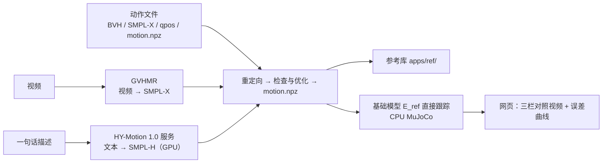

# 应用：视频学动作、一句话生成动作与手柄遥操作

> 一句话：参考动作不一定来自动捕。这两个应用分别从**一段视频**和**一句文字描述**得到人体动作，再走同一条"重定向 → 可行性检查与优化 → 转训练格式"的流水线，最后交给基础动作模型的 `E_ref` 直接跟踪（不需要重新训练），在网页上回放对照结果。
>
> 代码：`infra/q1infra/video/`（视频 → 人体动作）、`infra/q1infra/text2motion/`（文本 → 人体动作的生成服务）、`apps/track_web/`、`apps/text2motion/`（两个网页）、`apps/ref/`（参考库）。手柄遥操作见 [第 5 节](#5-手柄遥操作)（`apps/teleop/`）。

本文中标 **🛠️ 需要你自己处理** 的步骤，仓库没有、也不能替你完成（第三方模型、许可、权重、硬件），请按说明自行准备。

## 1. 整体结构



| 应用 | 入口 | 默认端口 | 网页里能上传 / 输入 |
|---|---|---|---|
| 动作跟踪 | `infra/bin/q1py -m apps.track_web` | 8765 | 10 s 以内的视频、LAFAN1 BVH、SMPL-X / AMASS npz、Q1 qpos npz、`motion.npz` |
| 文本生成动作 | `infra/bin/q1py -m apps.text2motion` | 8766 | 一句描述、时长（1–10 s，空为 5 s）、随机种子、是否改写成英文 |

两个网页共用同一套代码：只用 Python 标准库的 HTTP 服务，单页前端 `apps/track_web/index.html`；一次跑一个任务，其余排队；每个任务是一个子进程，崩溃不影响网页；失败后可以"重试"，已完成的中间结果（GVHMR、生成的人体动作、重定向）会复用。

## 2. 共同前提

**🛠️ 需要你自己处理：基础模型权重包。** 仓库不发布训练好的权重。请按 [训练与评测](training.md) 训练，再用 `export_base_package.py` 导出（见 [导出与部署](deployment.md#11-基础动作模型)），启动网页时用 `--package` 指定。

其余环境与数据处理相同：`bash infra/setup.sh`。网页的流水线子进程会自动把 `infra/SuperMimic-Q1/src` 加进 `PYTHONPATH`（只用到其中的 `motion.npz` 转换函数，不需要 GPU 和 mjlab）。

**参考库 `apps/ref/`**：网页生成的参考自动存成 `apps/ref/<来源>/<任务 id>.npz`（来源为 `track_web` / `text2motion` / `skills`），旁边的同名 `.json` 记录输入、可行性和 `E_ref` 跟踪结果。`infra/bin/q1py -m apps.ref` 列出全部参考。参考可以直接交给运行时播放（[导出与部署](deployment.md#3-运行时-runtime)）。数据不入库。

任务目录在 `infra/jobs/web_<时间>_<名字>/`（视频 / 动作文件）和 `infra/jobs/t2m_<时间>_<描述>/`（文本），可用 `--jobs-dir` 改。

## 3. 视频学动作

### 3.1 流程

1. **截取**：网页里设起止点，截到 10 s 以内；
2. **提取**（GVHMR）：先统一成 30 fps（GVHMR 默认按 30 fps 理解输入），依次做人体检测跟踪（YOLOv8）、2D 关键点（ViTPose）、特征（HMR2）、相机运动估计（勾选"固定机位"时跳过），由 GVHMR 输出世界坐标系下的 SMPL-X 人体动作；
3. **质量门槛**：肩、髋、膝、踝 8 个关键点置信度都 > 0.5 才算"这一帧全身可见"；全身可见帧 ≥ 90% 且时长 ≥ 2 s 才放行（网页可勾选"门槛不过也继续"）；
4. **坐标转换**：GVHMR 是 Y 轴朝上，我们用 Z 轴朝上，整个人绕 x 轴转 90°。旋转要绕骨盆的静止位置转，否则根位置会偏：\(\text{trans}'=R(J_0+\text{trans})-J_0\)，\(J_0\) 是该体型下的骨盆静止位置；存成 AMASS 格式的 SMPL-X npz；
5. 之后与 SMPL-X 输入完全相同：重定向（默认把着地脚放平）→ 检查与优化（被判 `rejected` 时退回原轨迹）→ `motion.npz` → `E_ref` 跟踪。

### 3.2 安装 GVHMR

**🛠️ 需要你自己处理：GVHMR 及其模型文件。** GVHMR 是第三方项目，有自己的许可和依赖，仓库不包含。

1. 克隆 [GVHMR](https://github.com/zju3dv/GVHMR) 到 `infra/.deps/GVHMR`（或任意位置，用 `--gvhmr-root` / `$GVHMR_ROOT` 指定）；
2. 按 GVHMR 官方说明安装依赖，建议装在它自己的虚拟环境 `infra/.deps/GVHMR/.venv`（或用 `--gvhmr-python` / `$GVHMR_PYTHON` 指定 Python）；
3. 按 GVHMR 官方说明下载它的模型权重到 `inputs/checkpoints/`，其中 **SMPL / SMPL-X 人体模型需要你在官网注册后自行下载**；
4. **SMPL-X 模型同时要放一份到 `infra/data/body_models/smplx/`**：坐标转换要用它按体型算骨盆静止位置。

我们验证过的版本（供参考）：CUDA 机器按 GVHMR 官方环境；macOS（Apple Silicon，Python 3.10）用 torch 2.3.1 / torchvision 0.18.1、numpy 1.23.5、lightning 2.3.0、ultralytics 8.2.42、`av==13.0.0`、`pycolmap==3.10.0`（新版接口不兼容）、`setuptools<70`（Lightning 需要 `pkg_resources`），chumpy / cython_bbox 用 `--no-build-isolation` 安装，pytorch3d v0.7.8 从源码编译。

GVHMR 代码里写死了 CUDA。`gvhmr_infer.py` 在非 CUDA 设备上会在进程内把 `.cuda()`、YOLO 的设备、`torch.load` 的设备映射改到所选设备，GVHMR 仓库本身不用改。macOS 上检测、关键点、特征走 MPS，GVHMR 主网络改在 CPU 上跑（它在 torch 2.3 的 MPS 上会卡死在 GPU 同步里，CPU 上不到 1 s）。与 CUDA 结果对比：关节角平均差 0.002 rad、平移 7 mm。

### 3.3 使用

网页：

```bash
infra/bin/q1py -m apps.track_web --package <权重包目录> [--host 0.0.0.0] [--gvhmr-device auto|cuda|mps|cpu]
# 浏览器打开 http://localhost:8765
```

找不到 GVHMR 时网页照常启动，只是不接受视频，只接受动作文件。

命令行（只做到重定向，产物与 [数据处理](data.md#2-重定向把人的动作换算到-q1) 相同）：

```bash
cd infra
bin/q1py -m q1infra.video clip.mp4 --job my_video [--static-cam] [--f-mm 24] [--start-sec 1 --end-sec 9] [--render]
# GVHMR 装在另一台 GPU 机器上：视频和推理脚本经 rsync 传过去，结果拉回本机
bin/q1py -m q1infra.video clip.mp4 --job my_video --host <ssh 主机> \
    --remote-gvhmr-root <远程 GVHMR 目录> --remote-gvhmr-python <远程 Python>
```

**🛠️ 需要你自己处理（远程模式）**：配置好到 GPU 机器的 ssh 免密登录，远程机器上装好 GVHMR。

拍摄建议：全身始终入镜、单人、光线充足；固定机位时勾选"固定机位"；知道焦距时填等效全画幅焦距（如手机主摄 24 mm）。

## 4. 一句话生成动作

### 4.1 流程

1. **生成**：网页把描述发给 GPU 上常驻的 HY-Motion 1.0 服务。HY-Motion 是腾讯混元的文生 3D 人体动作模型（流匹配 DiT，约 10 亿参数，文本编码器 Qwen3-8B + CLIP），输出 SMPL-H 骨架的 22 个身体关节旋转与根平移，30 fps、Y 轴朝上、已经贴地；
2. **改写**：模型只认英文。描述含中文（或勾选"改写"）时，服务复用已加载的 Qwen3-8B 文本编码器（它本身就是完整的语言模型），按官方改写模板改写成英文，不额外加载官方 61 GB 的改写模型；
3. **时长**：由用户填（1–10 s，空为 5 s）。基础版 Qwen3-8B 估不准时长（"三个深蹲"也答 2 s），所以没有采用模型估计；
4. **坐标转换**：与视频相同，绕骨盆静止位置转成 Z 轴朝上，存成 AMASS SMPL+H 格式（体型统一用 SMPL-X 标准体型，需要 `infra/data/body_models/smplx/SMPLX_NEUTRAL.*`，见 [数据处理](data.md#1-支持的输入)）；网页另画一段人体骨架视频做对照；
5. 之后与动捕输入完全相同：重定向 → 检查与优化 → `motion.npz` → `E_ref` 跟踪。

**随机性**：同一句描述换随机种子会得到不同的动作。种子记在任务里，重试可复现；效果不好时先换种子，不行再把描述写得更具体或拆成几个动作。

### 4.2 部署 HY-Motion 服务

**🛠️ 需要你自己处理：HY-Motion 的许可、GPU 和权重。**

- **许可**：HY-Motion 1.0 以[腾讯混元社区许可](https://github.com/Tencent-Hunyuan/HY-Motion-1.0)发布，**不适用于欧盟、英国、韩国**。如果用它生成的动作去训练模型，训练出的模型可能属于该许可中的"模型衍生品"，需遵守同一协议。请在使用前自行阅读并确认；
- **硬件**：NVIDIA GPU，约 26 GB 显存（Lite 版约 24 GB），权重约 22 GB 磁盘；
- **网络**：需要能访问 ModelScope 或 Hugging Face 下载权重。

```bash
# GPU 机器上
git clone https://github.com/Tencent-Hunyuan/HY-Motion-1.0 && cd HY-Motion-1.0 && git lfs pull
HY_ROOT=$PWD bash <LocoInfra>/infra/q1infra/text2motion/setup_gpu.sh     # 建 .venv、下载权重到 ckpts/
# 磁盘不够时：HY_CKPT=/大盘/hymotion_ckpts；改从 Hugging Face 下载：HF_SOURCE=1

# 启动服务（工作目录必须是 HY-Motion 仓库根目录）
cd $HY_ROOT && .venv/bin/python <LocoInfra>/infra/q1infra/text2motion/hymotion_server.py [--port 8770] [--lite]
```

服务启动时加载一次模型（首次约 2 分钟），之后每条请求只做采样（几秒）；一次只算一条，排队由网页负责。接口：`GET /health` 返回模型、显存、是否忙；`POST /generate` 收 JSON（`text`、`duration`、`seed`、`cfg_scale`、`rewrite`、`max_duration`），返回 npz。

**🛠️ 需要你自己处理：显存调度。** 服务常驻约 21–26 GB 显存。和训练在同一台机器上时要算进显存预算，或者训练前先停掉服务。

### 4.3 使用

```bash
# 网页和服务在同一台机器
infra/bin/q1py -m apps.text2motion --package <权重包目录> [--host 0.0.0.0]
# 服务在另一台 GPU 机器：先把端口转发到本机
ssh -N -L 8770:127.0.0.1:8770 <GPU 机器> &
infra/bin/q1py -m apps.text2motion --package <权重包目录> --t2m-url http://127.0.0.1:8770
# 浏览器打开 http://localhost:8766
```

**输入约束**：描述最好是英文、60 个词以内，只描述单人的身体动作；不支持物体和场景交互、情绪与外观、多人、无限循环的动作。Q1 自身的限制照旧（体型小、没有手腕、踝力矩小、腰不能前后弯），生成的高难度动作以可行性检查和跟踪结果为准。

## 5. 手柄遥操作

用 Xbox 布局的手柄实时驱动基础模型的 `E_tele`：左摇杆前后 / 左右走，右摇杆转身，十字键 ↑↓ 调高度（下蹲）、←→ 调速度系数，Y 高度回正，BACK 急停切阻尼。机器人从趴姿开始：L2+A 起身 → 行走 → L2+B 站直后趴下。仿真和真机是同一个状态机（`apps/teleop/machine.py`）。默认用发布的基础模型 `weights/dual_v3b` 和起身 / 趴下技能 `weights/getup_vpd_ft`（[验收结果](../weights/README.md#getup_vpd_ft)），开箱可用。

### 5.1 仿真

```bash
infra/bin/q1py -m apps.teleop                                     # 开窗口，GLFW 读手柄（Mac / Linux）
infra/bin/q1py apps/teleop/sim.py                                 # 同上，另有键盘控制和命令 / 实测速度箭头
infra/bin/q1py -m apps.teleop --script 'idle:1,getup:12,fwd:3,turn_l:2,squat:1,rise:1,liedown:14'   # 无界面自测
```

换成自己训练的技能包用 `--skill <技能包>`。找不到技能包时从站姿开始，只能行走（L2+A / START 回到站姿）。

### 5.2 起身 / 趴下技能

参考轨迹随仓库发布在 `apps/ref/skills/`：`getup_facedown`（俯卧起身，9.1 s）、`liedown_facedown`（站立趴下，8.5 s），50 Hz 的 `motion.npz`，首尾带静止段。发布的 `weights/getup_vpd_ft` 就是在它们上训练的。想自己训练（GPU，约 1.5 + 1.5 h，再按需续训）：

```bash
cd infra/SuperMimic-Q1
scripts/train/getup.sh getup_v1
scripts/train/getup.sh getup_v2 --resume logs/getup_v1/ckpt_latest.pt \
    --reward.w-extra-contact -2 --reward.w-impact -5 --schedule.max-hours 1.5
# 可选：换成低增益预设续训（getup_vpd_ft 的做法；训练、评测、导出都要带同一个 Q1_PD）
Q1_PD=vendor_getup scripts/train/getup.sh getup_vpd_ft --resume logs/getup_v2/ckpt_latest.pt \
    --reward.w-extra-contact -2 --reward.w-impact -5
Q1_PD=vendor_getup SUPERMIMIC_ROBOT=q1 .venv/bin/python scripts/export_package.py --ckpt logs/getup_vpd_ft/ckpt_latest.pt \
    --motion-npz ../../apps/ref/skills/getup_facedown.npz --out ../jobs/getup/artifact
```

用 `--skill infra/jobs/getup/artifact` 交给遥操作。第二轮的两项接触惩罚很关键：不加时策略会在起身最后一下用膝盖约 2 m/s 砸地借力，加上后近地最大下落速度降到约 0.6 m/s，结果见 [实验结果](results.md#22-单段动作验收)。`Q1_PD=vendor_getup` 是 Q1 厂商起身 / 趴下用的低增益（髋膝 30、踝 20、腰 roll 80 / yaw 30、臂 20），检查点会记录预设，评测、导出时不一致直接报错；技能包与基础模型增益不同时，切换时增益与关节目标都在 0.4 s 内线性过渡。

### 5.3 真机（Q1 / PrimeBot SDK）

**🛠️ 需要你自己处理**：PrimeBot SDK（ROS 2 Humble + `aimdk_msgs`）、吊带与急停。本仓库不附带 SDK。

```bash
# 运控板上：APP 开发者模式选「低层运控开发」、关掉高层运控；吊带兜住
source /opt/ros/humble/setup.bash && source <SDK 工作空间>/install/setup.bash
python3 -m apps.teleop --backend real --dry-run                           # 演练：指令发到假话题，电机不动
python3 -m apps.teleop --backend real --speed-scale 0.5
python3 -m apps.teleop.getup_test                                         # 不接手柄，单独测起身 / 趴下
python3 apps/teleop/autostart/install.py                                  # 可选：开机自启（重启后生效）
```

真机后端 `runtime.PrimeBotBackend` 只用 SDK 文档里的接口：订阅 `/aima/hal/joint/state`、`/aima/hal/imu/state`，以 500 Hz 发布 `/aima/hal/joint/command`（策略目标零阶保持，每帧位置增量 ≤ 0.2 rad）；收、发各占一个子进程和一个大核。关节或 IMU 断流超过 0.1 s、策略超时、进程退出、起身前插值时关节偏离指令过大，都会自动切阻尼。检测到厂商运控在运行时拒绝启动。每个阶段有语音提示（机器人扬声器），活动记录默认写到 `/robot/persist/log/kabutack_teleop/rec/`，用 `python -m apps.teleop.recorder <目录>` 查看。

> ⚠️ 真机运行有摔倒、损坏设备和伤人的风险。请阅读 README 中的免责声明，先 `--dry-run`、再吊带下低速测试。

## 6. 两种来源的对比

| | 视频学动作 | 一句话生成动作 |
|---|---|---|
| 参考来源 | 真人示范，动作一定是人能做的 | 模型生成，可能有滑脚、穿地、不合物理的过渡 |
| 质量把关 | 全身可见率、时长；可行性检查 | 时长 1–10 s；可行性检查 |
| 不满意时 | 换视频、改截取区间、勾选固定机位 / 填焦距 | 换种子、改描述 |
| 可复现 | 视频文件 + 截取区间 | 描述 + 种子 + CFG + 模型版本 |
| 需要 GPU | 推荐（macOS MPS 也能跑，10 s 视频约 2 分钟） | 必须（服务端） |

实测结果见 [实验结果](results.md#24-直接跟踪新动作不微调)：网球发球视频直接跟踪关节误差 0.083 rad；10 段文本生成动作全部不摔，关节误差 0.045–0.095 rad。单条文本任务 15–20 s（生成 4–7 s，重定向 ≤ 1 s，优化 1–8 s，跟踪 4–5 s）。

## 7. 已知局限

- 只做"直接跟踪"，还没有"跟不好时只微调 `E_ref`"的闭环；
- 网页只有视频回放，没有浏览器里的 3D 交互查看；
- 生成动作偶尔不听描述（漏掉其中一个动作）或有不合物理的过渡，不能把生成结果当作真机安全的依据；
- 动作首尾没有自动补站姿，机器人从参考首帧姿态直接开始。
