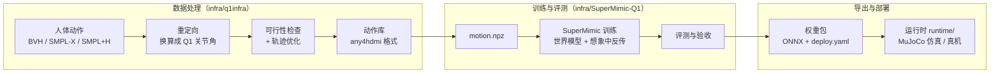
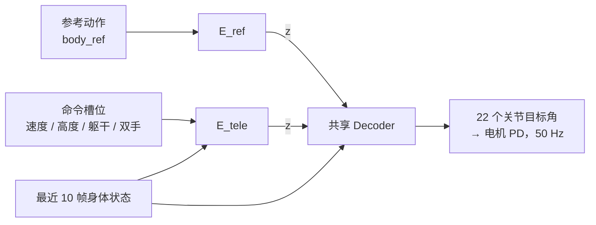

# 概览

> 这篇讲清楚三件事：LocoInfra 要解决什么问题、整条流水线长什么样、几个核心概念是什么意思。具体做法分别见 [数据处理](data.md)、[训练与评测](training.md)、[导出与部署](deployment.md)、[应用](apps.md)，实验数字见 [实验结果](results.md)。

## 1. 要解决的问题

我们想让一台小型人形机器人（Q1，22 个关节，高 0.88 m，重 16.9 kg）学会人的各种动作：走、转身、下蹲、弯腰、挥手、搬东西……

最直接的做法是"每个动作单独训练一个控制器"，但这样动作一多就无法维护，也没法响应实时指令。LocoInfra 的做法是：

1. 把大量人体动作数据（动捕文件）**换算**成 Q1 能做的动作，并筛掉做不了的部分；
2. 在仿真里用这几十小时的动作训练**一个通用控制模型**——我们叫它**基础动作模型**；
3. 把模型导出成一个**权重包**，在任何地方（仿真或机器人板上）用 ONNX Runtime 以 50 Hz 推理。

基础动作模型有两种用法：

- **照着参考做**：给它一段完整的参考动作（比如一段舞），它让机器人跟着做；
- **听命令做**：只给它几个简单的命令（往前走多快、蹲多低、手放在哪），它自己生成协调的全身动作。

## 2. 整条流水线

每一步的输出都单独存盘，哪一步出问题只重跑那一步：

| 步骤 | 输入 → 输出 | 代码 | 在哪跑 |
|---|---|---|---|
| 重定向 | 人体动作 → Q1 关节轨迹（50 Hz） | `infra/q1infra/retarget/` | CPU（笔记本即可） |
| 可行性检查 / 轨迹优化 | Q1 轨迹 → 检查报告 / 修正后的轨迹 | `infra/q1infra/feasibility/` | CPU |
| 轨迹查看与手改 | 轨迹 → 修改后的轨迹 | `infra/q1infra/viewer/` | 有显示器的机器 |
| 建动作库 | 一批源文件 → 一个 any4hdmi 动作库 | `infra/q1infra/dataset.py` | 多核 CPU |
| 转训练格式 | 动作库 → `motion.npz` | `infra/SuperMimic-Q1/scripts/data/` | CPU |
| 训练 | `motion.npz` → 检查点 | `infra/SuperMimic-Q1/src/supermimic/` | NVIDIA GPU |
| 评测 | 检查点 → 报告 | `infra/SuperMimic-Q1/scripts/eval_*.py` | GPU |
| 导出 | 检查点 → 权重包 | `infra/SuperMimic-Q1/scripts/export_*.py` | GPU / CPU |
| 部署 | 权重包 → 控制循环 | `runtime/` | CPU |
| 应用 | 视频 / 一句话 → 参考动作 → `E_ref` 直接跟踪 | `apps/`、`infra/q1infra/{video,text2motion}/` | CPU；视频提取推荐 GPU，文本生成必须 GPU |

## 3. 术语表

| 术语 | 通俗解释 | 专业定义 |
|---|---|---|
| 重定向（retarget） | 把人的动作"翻译"成机器人的关节角度。人和 Q1 体型、关节都不一样，不能直接照搬 | 按骨长比例缩放人体关键点后，逐帧求解逆运动学（GMR） |
| 可行性检查 | 检查翻译后的动作 Q1 能不能真做出来 | 逐帧检测关节限位、穿模、接触、滑脚 / 悬空、逆动力学力矩和根部力平衡 |
| 参考动作 | 机器人"应该做成这样"的目标动作，训练和评测的标准答案 | 50 Hz 的 qpos 序列及其正运动学量 |
| 动作库 | 很多段参考动作的集合 | 一个 any4hdmi 数据集（`manifest.json` + `motions/*.npz`） |
| 策略（policy） | 控制器神经网络：每 0.02 s 看一次身体状态和目标，输出关节该转到的角度 | \(\pi(a_t \mid o_{t-9:t}, g_t)\)，输出 22 维 PD 目标偏移 |
| 世界模型 | 学出来的"仿真器替身"，能预测下一刻机器人会怎样 | 以仿真上下文 \(\xi\) 为条件的可微动力学 MLP |
| 想象训练 | 在世界模型里推演几十步，沿推演轨迹直接求梯度改进策略 | 短视野 BPTT（SHAC 式 actor-critic） |
| Encoder / Decoder | 模型的两段：Encoder 把"目标"压成一个 32 维意图向量 `z`，Decoder 根据 `z` 和身体状态出动作 | \(z=E(g)\)，\(a=D(z,o_{t-9:t})\) |
| `E_ref` | 读完整参考动作的 Encoder | 输入 `body_ref`（未来 4 帧参考 + 躯干相对朝向，222 维） |
| `E_tele` | 读简单命令的 Encoder | 输入遥操作槽位 + 掩码 + 观测历史 |
| 槽位（slot） | 命令按部位拆成的格子：底盘速度、高度、躯干倾斜、左手、右手、（预留）双脚 | 注册表 `supermimic/tele/slots.py`，只追加不修改 |
| 掩码（mask） | 每个槽位"这次填了没有" | 每槽 1 位，被屏蔽的槽位输入置 0 |
| 随机化 | 训练时故意把摩擦、质量、电机强弱、延迟变一变，让策略不依赖某组精确参数 | domain randomization，每个环境每类参数抽一个标量并写入 \(\xi\) |
| 留出集 | 随机拿出 3% 的动作不参与训练，专门测"没见过的动作做得怎样" | 固定种子划分 |
| 回报 | 跟踪得分，0–1，越接近 1 越像参考 | 归一化回报 = 总奖励 / (单步最大奖励 × 步数) |
| 权重包 | 训练好的模型导出成的部署文件夹 | ONNX 图 + `deploy.yaml` + `scene.xml` + 评测报告 |

## 4. 基础动作模型一图看懂

- **Decoder 只被 `E_ref` 的训练更新**。训练 `E_tele` 时 Decoder 冻结，所以命令驱动的动作"长相"永远来自动作库里的真人动作，命令侧怎么改都不会破坏参考跟踪能力。
- 两个 Encoder 输出在同一个 32 维潜空间里，切换用法时只需在若干步内把 `z` 从旧值平滑插到新值。
- 世界模型和打分网络（critic）只在训练时用，不进权重包。

为什么分成两个 Encoder 而不是一个：两种输入的信息量差一个数量级（参考 222 维，命令十几维），放进同一个 Encoder 它会只盯着信息多的一边；分开后两边可以独立扩展（例如给命令加一个新槽位）而互不影响。详见 [训练与评测](training.md#2-基础动作模型)。

## 5. Q1 机器人与约束

Q1 有 22 个可控关节：每条腿 6 个、腰 2 个（侧弯、转身）、每条手臂 4 个，**没有手腕**。只有关节编码器和骨盆 IMU，**不知道自己在世界里的绝对位置**。

| 部位 | 峰值力矩 | 额定（持续）力矩（估计） |
|---|---|---|
| 髋、膝、腰 | 35 N·m | 约 11.7 N·m |
| 踝、手臂 | 22 N·m | 约 7.3 N·m |

公开模型只给了峰值力矩（36 / 22 N·m，髋膝腰保守取 35）；额定力矩按峰值的 1/3 估计。

这些硬件条件直接决定了哪些动作能做：

| 硬件条件 | 对动作的影响 |
|---|---|
| 体型约为人的一半（腿长 0.44 m） | 移动距离和步幅按腿长比例缩小（约 0.45 倍） |
| 没有手腕 | 手只能跟位置，跟不了朝向 |
| 腰不能前后弯 | 弯腰只能靠髋关节折，大幅弯腰会走样 |
| 踝力矩小 | 长时间单脚站、单脚跳基本做不了 |
| 没有全局定位 | 长距离动作只保证"样子像"，不保证走到同一个位置；策略观测里也不给相对位置 |

训练用的是碰撞简化版模型 `q1/q1_v3/xml/q1_v3_collision.xml`（由 `build_collision.py` 从原始模型生成）：外形网格只和地面碰撞，每只脚底 4 个小球接触地面，关节限位比实测范围两端各收 1°。电机参数（峰值 / 额定力矩、转速、转子惯量及随机化范围）在 `q1/motor_id/prior.npz`，推导过程见 [`q1/motor_id/README.md`](../q1/motor_id/README.md)。

## 6. 模块之间的约定

只要下面这些约定不变，任何一层内部换实现（换重定向方法、换训练算法），其他层都不用改：

| 约定 | 内容 |
|---|---|
| 机器人 | 关节顺序以 `q1_v3_collision.xml` 为准 |
| 动作数据 | 重定向之后统一存成 any4hdmi 格式（50 Hz，每帧 29 维 qpos：根位置 3 + 四元数 4 + 22 关节）；训练只读 `motion.npz` |
| 策略 | 输入最近 10 帧本体状态 + 目标，输出 22 个关节目标角，由电机 PD 执行，50 Hz |
| 目标接口 | `E_ref` 读 `body_ref`；`E_tele` 读槽位注册表定义的槽位。两者共用 Decoder |
| 产物 | 一个权重包：ONNX 图、`deploy.yaml`（输入怎么拼全写在这里）、训练场景、评测报告 |

扩展时的原则：

- 对所有动作都有用的改进（新输入格式、训练更稳、新评测项）放进工具链；
- 命令想多控制一样东西：给 `E_tele` 加一个槽位接着训，不另起 Encoder、不动 Decoder；
- 新的输入设备或数据源：在外部写适配器，翻译成已有的槽位或参考动作，模型不动；
- 动作库里没有的动作：补数据给 `E_ref` 训练，而不是放开 Decoder 给命令侧改；
- 只对某个场景有用的东西（特定物体、特殊接触规则）不进主干，单独维护。
